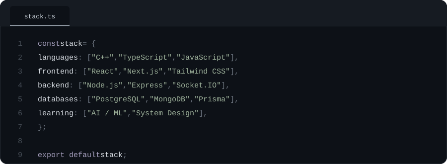

  

  <a href="mailto:harshrajput0043@gmail.com">Email</a>
  &nbsp;&nbsp;/&nbsp;&nbsp;
  <a href="https://www.linkedin.com/in/harshrajput0402">LinkedIn</a>
  &nbsp;&nbsp;/&nbsp;&nbsp;
  <a href="https://github.com/harshrajput0402">GitHub</a>
  &nbsp;&nbsp;/&nbsp;&nbsp;
  <a href="https://leetcode.com/u/harshrajput0402/">LeetCode</a>

 

  I build scalable web applications, lean towards the backend, and sharpen my thinking with data structures and algorithms. 
  Currently studying OS, networks, DBMS and system design on the way to my first software engineering role.

 

  

 

  Always learning, building, and improving.

